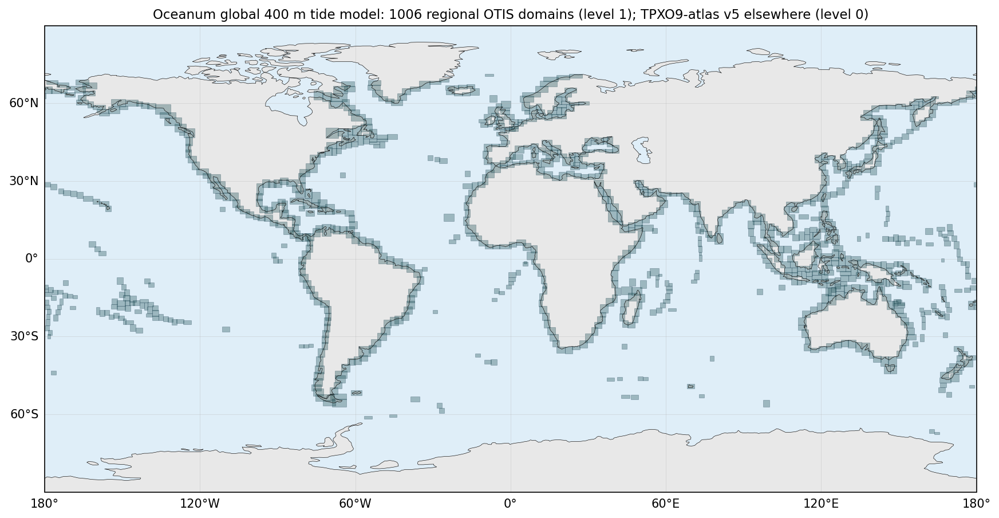
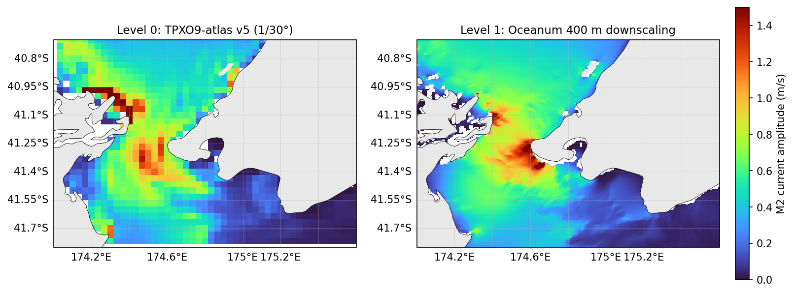

  

# Oceanum Global Multiscale Tide Model

**September 2026**

| | |
|---|---|
| **Model** | OTIS (OSU Tidal Inversion Software), forward barotropic solver |
| **Coverage** | Global; 0.004 degree (~400 m) along the world's coastlines, 1/30 degree (~3.7 km) elsewhere |
| **Constituents** | M2, S2, N2, K2, K1, O1, P1, Q1, MM, MF, M4, MN4, MS4, 2N2 |
| **Outputs** | Harmonic constants and reconstructed time series of tidal elevation and depth-averaged tidal currents |
| **Boundary conditions** | TPXO9-atlas v5 |
| **Bathymetry** | GEBCO 2021 Grid |

---

## Dataset description

The Oceanum Global Multiscale Tide Model provides tidal elevations and depth-averaged tidal currents for any location and time, worldwide. It combines two levels of information in a single dataset: a global tidal atlas at 1/30 degree resolution, and approximately one thousand high-resolution regional tide model domains at 0.004 degree (~400 m) resolution that follow the world's coastlines. Wherever a high-resolution domain exists, its solution is served; elsewhere, the global atlas is interpolated to the same 400 m grid, so that users see one seamless global dataset. The dataset is stored as harmonic constants (complex amplitudes of each tidal constituent), from which elevation and current time series are reconstructed on demand for any past or future period.

The global level is the <a href="https://www.tpxo.net/global/tpxo9-atlas" target="_blank">TPXO9-atlas v5</a> of Oregon State University, a data-assimilative barotropic tide model constrained by more than two decades of satellite altimetry. The high-resolution level was produced by Oceanum with the <a href="https://www.tpxo.net/otis" target="_blank">OSU Tidal Inversion Software (OTIS)</a>, using its forward model without data assimilation. OTIS solves the linearised, depth-integrated shallow-water equations for each tidal constituent independently in the frequency domain, on an Arakawa C grid, with a linear parameterisation of bottom friction and self-attraction and loading effects prescribed from a global model (<a href="https://journals.ametsoc.org/view/journals/atot/19/2/1520-0426_2002_019_0183_eimobo_2_0_co_2.xml" target="_blank">Egbert and Erofeeva, 2002</a>). Elevations are obtained by direct factorisation of the elevation wave equation and the transports are then recovered from the elevation gradient through the momentum balance.

Regional domains were laid out as overlapping boxes, typically 2 to 4.5 degrees on a side, following the coastline at an offshore distance of about 50 km (Figure 1). Each domain was modelled in two steps. A parent domain at 0.02 degree resolution, extending one degree beyond the child domain on all sides, was first forced along its open boundary with tidal elevations from TPXO9-atlas v5. The parent solution was then used to prescribe elevations along the open boundary of the 0.004 degree child domain. This nesting reduces boundary discontinuities and numerical noise at the edges of the high-resolution domain. Bathymetry for both levels was taken from the <a href="https://www.gebco.net/data_and_products/gridded_bathymetry_data/" target="_blank">GEBCO 2021 Grid</a>, with a minimum water depth of 2 m; cells shallower than 2 m are treated as land. Fourteen constituents were solved in every domain: eight primary constituents (M2, S2, N2, K2, K1, O1, P1, Q1), two long-period constituents (MM, MF), three shallow-water constituents (M4, MN4, MS4) and 2N2. All regional domains were run in parallel on Oceanum's cloud infrastructure, each in its own container sized to the memory requirements of the direct solver.

The individual domain solutions were merged into a single sparse, multiscale archive. A global 0.004 degree template was defined, each regional solution was interpolated onto it, and overlapping areas between neighbouring domains were averaged. The archive is served through Datamesh by a driver that, for every request, uses the 400 m solution where it exists and fills the remaining area by interpolating the global atlas onto the same grid, applying the merged land mask so that coastlines are consistent. Time series of elevation and currents are synthesised from the harmonic constants at query time, including nodal corrections, at any requested time step. Figure 2 illustrates the gain in spatial detail provided by the 400 m level relative to the global atlas.

**Figure 1.** Footprints of the 1006 regional 400 m OTIS domains (level 1). Outside these footprints the TPXO9-atlas v5 (level 0) is interpolated to the same 400 m grid.

**Figure 2.** M2 tidal current amplitude in Cook Strait, New Zealand, from the global atlas (left) and from the 400 m downscaled level (right).

---

## Model limitations

The regional level is a purely dynamical downscaling: no observations were assimilated in the 400 m domains, so their accuracy depends on the boundary information inherited from the global atlas, on the bathymetry, and on the model physics. OTIS solves linearised equations without advection, wetting and drying, horizontal mixing, stratification or mean flows, and with a linear bottom friction whose depth dependence is capped in water shallower than 10 m. These simplifications are adequate over continental shelves and in well-resolved coastal seas, but they limit accuracy in estuaries, tidal rivers, macrotidal embayments with extensive intertidal flats, and regions with large river discharge or soft muddy beds. In such environments, elevation amplitudes may be under-predicted and the timing of high water and of the turn of the current may differ from observations by an hour or more. GEBCO bathymetry is itself of variable quality close to the coast, and channels narrower than a few grid cells or shallower than 2 m are not represented. Where neighbouring 400 m domains overlap, their solutions are averaged and small discontinuities can be visible, particularly in the currents. The dataset has been compared with the global atlas and with tide observations in selected regions only; users working in shallow estuarine environments are encouraged to validate against local tide tables or measurements.

---

## Data description

**Table 1.** Data description.

| Field | Value |
|---|---|
| **Title** | Oceanum global multiscale tide model |
| **Institution** | <a href="https://oceanum.io" target="_blank">Oceanum</a> |
| **Access** | <a href="https://ui.datamesh.oceanum.io/" target="_blank">Oceanum Datamesh</a> |
| **Source** | <a href="https://www.tpxo.net/otis" target="_blank">OTIS</a> forward model (<a href="https://journals.ametsoc.org/view/journals/atot/19/2/1520-0426_2002_019_0183_eimobo_2_0_co_2.xml" target="_blank">Egbert and Erofeeva, 2002</a>) |
| **Temporal coverage** | Any period (harmonic prediction); time series served from 1970-01-01 |
| **Temporal resolution** | User defined (default hourly) |
| **Spatial coverage** | Global, [-180E, -90N, 180E, 90N] at 0.004 degree |
| **High-resolution domains** | 1006 regional domains at 0.004 degree along the world's coastlines |
| **Constituents** | M2, S2, N2, K2, K1, O1, P1, Q1, MM, MF, M4, MN4, MS4, 2N2 |
| **Nesting** | 0.02 degree parent domain (1 degree offset) forced by TPXO9-atlas v5; 0.004 degree child forced by the parent |
| **Bathymetry** | <a href="https://www.gebco.net/data_and_products/gridded_bathymetry_data/" target="_blank">GEBCO 2021 Grid</a>, 2 m minimum depth |
| **Global level** | <a href="https://ui.datamesh.oceanum.io/datasource/tpxo9_atlas_v5_cons" target="_blank">TPXO9-atlas v5</a> (1/30 degree) |

### Linked Datamesh datasources

- <a href="https://ui.datamesh.oceanum.io/datasource/oceanum_global_multiscale_tidegrid" target="_blank">Oceanum global tides constituents and timeseries on a multiscale 400m grid</a>
- <a href="https://ui.datamesh.oceanum.io/datasource/oceanum_global_multiscale_tidegrid_timeseries" target="_blank">Oceanum global tides timeseries on a multiscale 400m grid</a>
- <a href="https://ui.datamesh.oceanum.io/datasource/tpxo9_atlas_v5_cons" target="_blank">TPXO9-atlas v5 global tidal constituents</a>

---

## Harmonic constants

Harmonic constants are stored as complex amplitudes for each constituent on the global 0.004 degree grid. Amplitude is the modulus of the complex value and the Greenwich phase lag is `atan2(-imag, real)`. Table 2 describes the constituent variables.

**Table 2.** Harmonic constant variables.

*Variable names link to the corresponding <a href="https://vocab.nerc.ac.uk/standard_name/" target="_blank">NERC Vocabulary Server</a> standard name where available. All variables are defined on the `con`, `latitude` and `longitude` coordinates unless noted; complex variables are served as `<variable>_re` and `<variable>_im` components.*

| Variable | Long Name | Units |
|---|---|---|
| <a href="https://vocab.nerc.ac.uk/standard_name/sea_floor_depth_below_mean_sea_level/" target="_blank">dep</a> | bathymetry (`latitude`, `longitude`) | m |
| h | tidal elevation complex amplitude | m |
| <a href="https://vocab.nerc.ac.uk/standard_name/land_binary_mask/" target="_blank">landmask</a> | land mask, 1 = land, 0 = sea (`latitude`, `longitude`) | - |
| u | tidal eastward velocity complex amplitude | m/s |
| v | tidal northward velocity complex amplitude | m/s |

---

## Time series output

Time series are reconstructed from the harmonic constants at the requested times, with nodal corrections applied. Table 3 describes the time series variables.

**Table 3.** Time series variables.

*Variable names link to the corresponding <a href="https://vocab.nerc.ac.uk/standard_name/" target="_blank">NERC Vocabulary Server</a> standard name where available. All variables are defined on the `time`, `latitude` and `longitude` coordinates.*

| Variable | Long Name | Units |
|---|---|---|
| <a href="https://vocab.nerc.ac.uk/standard_name/tidal_sea_surface_height_above_mean_sea_level/" target="_blank">h_ts</a> | tidal elevation timeseries | m |
| <a href="https://vocab.nerc.ac.uk/standard_name/eastward_sea_water_velocity/" target="_blank">u_ts</a> | tidal eastward velocity timeseries | m/s |
| <a href="https://vocab.nerc.ac.uk/standard_name/northward_sea_water_velocity/" target="_blank">v_ts</a> | tidal northward velocity timeseries | m/s |

---

www.oceanum.science
