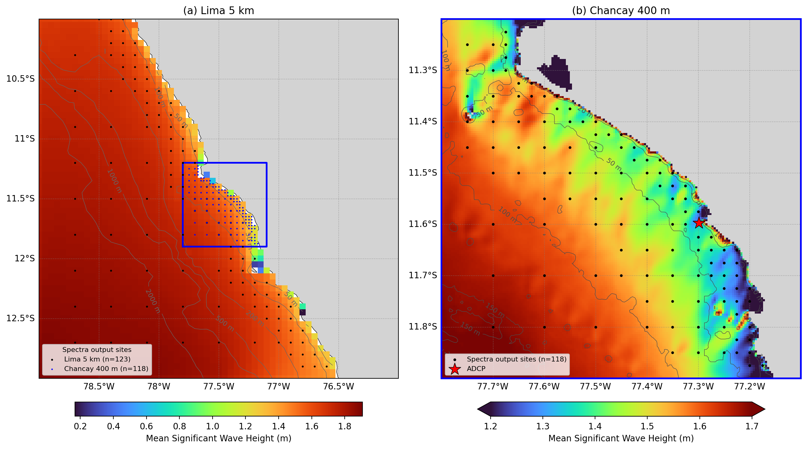
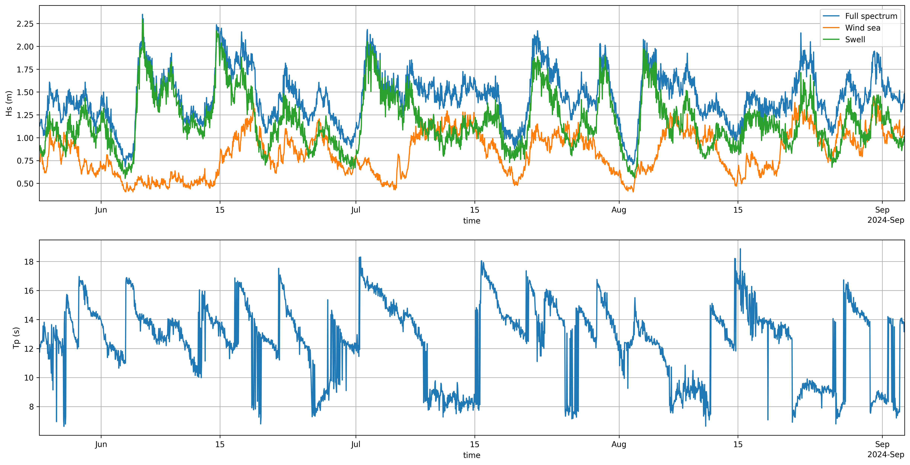
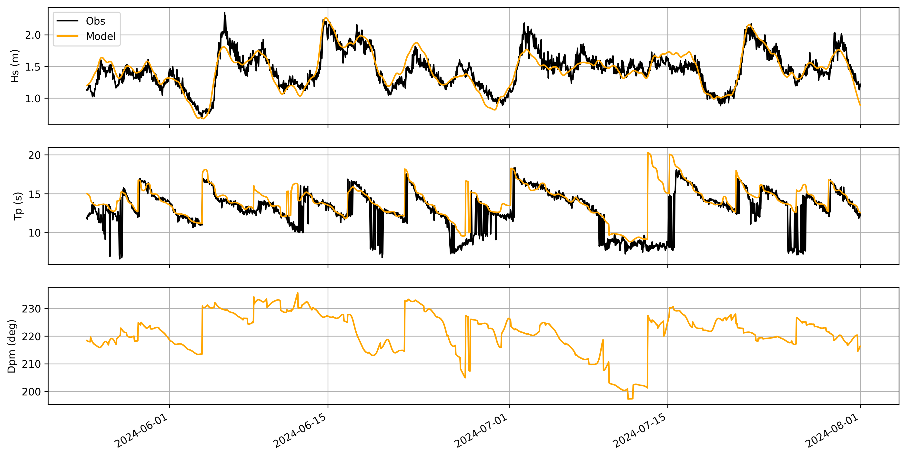
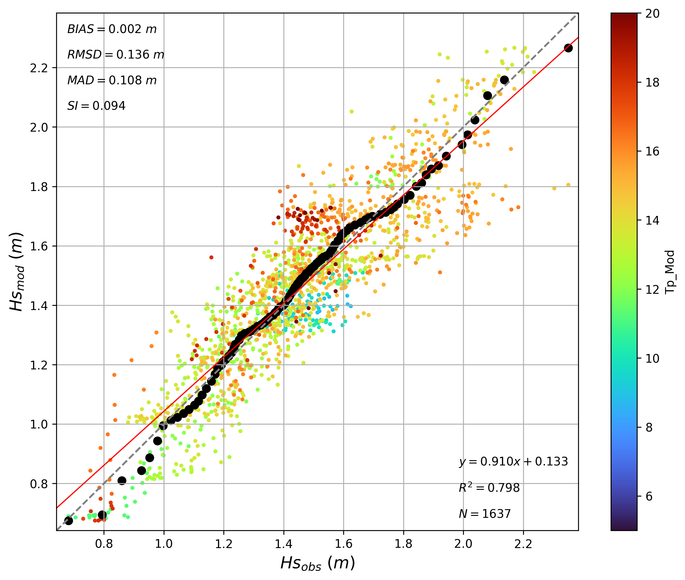
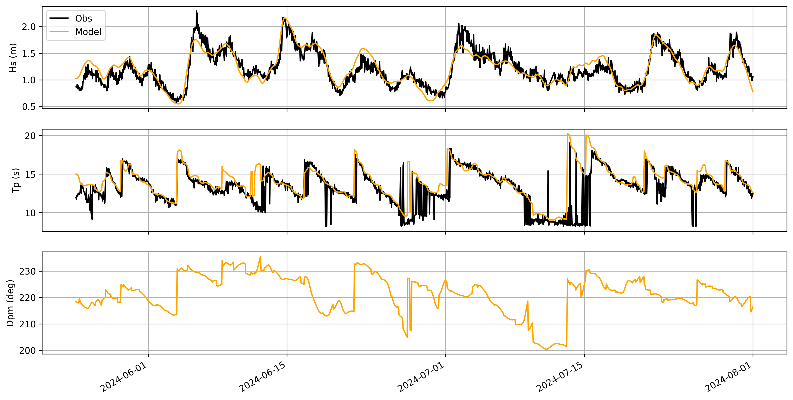
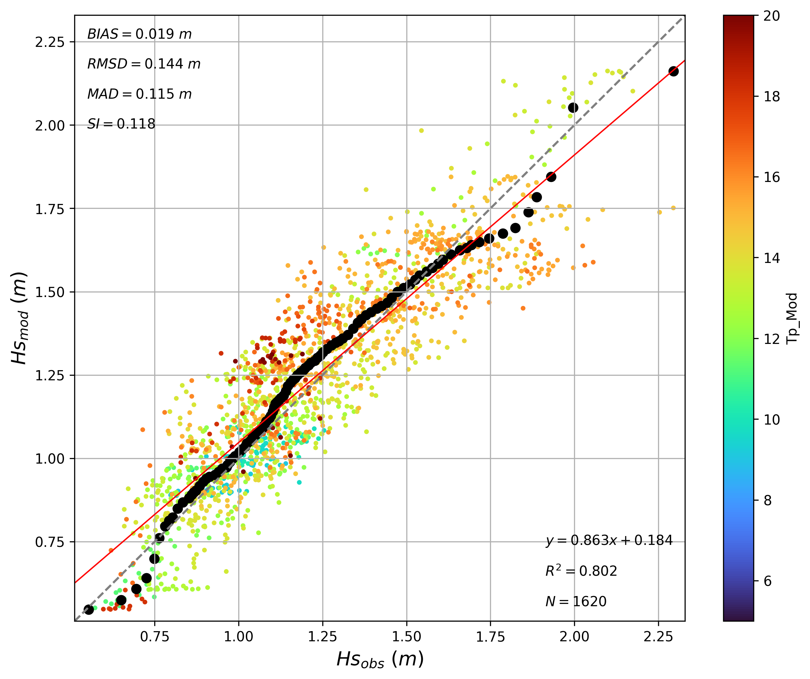

  

# Oceanum Peru Wave Forecast

**November 2026**

| | |
|---|---|
| **Model** | SWAN 41.31 |
| **Forecast horizon** | 7 days |
| **Spatial resolution** | 0.05 degree (~5 km, Lima), 0.004 degree (~400 m, Chancay) |
| **Temporal resolution** | 1 hourly |
| **Region** | 79W - 76W, 13S - 10S |
| **Forcings** | GFS/ECMWF winds and Oceanum spectra |
| **Update frequency** | 6-hourly (GFS) / 12-hourly (ECMWF) |

---

## Dataset description

The Peru wave forecast dataset provides operational wave predictions along the central Peruvian coast, covering the Lima metropolitan region and the port of Chancay (Figure 1). Wave forecasts are produced using the SWAN (Simulating WAves Nearshore) third-generation spectral wave model, with a 7-day forecast horizon. The forecast uses the same domains and model setup as the <a href="./oceanum_peru_wave_hindcast.html">Oceanum Peru ERA5 wave hindcast</a>, with a different set of spectra output sites.

Two forcing configurations are available: <a href="https://www.ncep.noaa.gov/products/gfs/" target="_blank">NOAA GFS</a> updated every 6 hours (00, 06, 12, 18 UTC) and <a href="https://www.ecmwf.int/en/forecasts/datasets/open-data" target="_blank">ECMWF IFS</a> updated every 12 hours (00, 12 UTC). Spectral boundary conditions are supplied by the Oceanum Global WW3 wave forecast forced with the respective wind source. Bathymetry is derived from the <a href="https://www.gebco.net/data_and_products/gridded_bathymetry_data/" target="_blank">GEBCO 2026</a> global bathymetric grid.

The modelling setup employs the <a href="https://journals.ametsoc.org/view/journals/atot/29/9/jtech-d-11-00092_1.xml" target="_blank">ST6</a> source term parameterisations. Spectra are discretised into 36 directional bins and 32 frequency bins, covering a frequency range from 0.037 to 0.71 Hz with 10% logarithmic increments. The model features a two-level nesting structure:

- **Lima 5 km** (0.05°): Parent domain covering the central Peruvian coast and adjacent South Pacific waters, 79W-76W, 13S-10S
- **Chancay 400 m** (0.004°): High-resolution nest covering Chancay Bay, the approaches to the Port of Chancay and the adjacent coast, 77.8W-77.1W, 11.9S-11.2S

The dataset provides hourly forecast estimates for key ocean wave parameters (Table 3) including spectral quantities integrated over the full spectrum and for spectral partitions. Partitions are defined from an 8-second split (sea/swell) and from the Watershed method, which identifies one wind-forced partition and up to three swell partitions. Forecasts are archived for 7 days, and frequency-direction wave spectra are available at 123 sites in the Lima 5 km domain and at 118 sites in the Chancay 400 m domain. Nowcast datasets are also available for both domains, constructed by retaining the most recent data from each forecast cycle to provide a continuous near-real-time historical record starting in November 2026.

**Figure 1.** Peru wave forecast domains. (a) Lima 5 km parent domain, with the mean significant wave height from the corresponding Peru ERA5 hindcast in the background and depth contours at 50m, 100m, 200m, 500m, 1000m, and 2000m; the blue box indicates the Chancay 400 m nest. The locations of 2D spectra hourly output are shown by the black dots (Lima 5 km, 123 sites) and the blue dots (Chancay 400 m, 118 sites). (b) Chancay 400 m nest, with the significant wave height averaged over a single 7-day forecast cycle in the background, shown for illustration on its own colour scale, and depth contours at 10m, 20m, 50m, 100m, 150m, and 200m. The black dots show the 118 spectra output sites of the nest and the red star marks the location of the ADCP used for validation.

---

## Validation

The model setup was validated against wave measurements from an Acoustic Doppler Current Profiler (ADCP) deployed off Chancay at 77.2990W, 11.5977S, within the Chancay 400 m domain (Figure 1b). The instrument recorded between late May and early September 2024, a period characterised by a succession of South Pacific swell events with significant wave heights between 0.7 and 2.4 m and peak periods mostly between 8 and 18 s (Figure 2).

**Figure 2.** Wave conditions measured by the ADCP off Chancay. Top: significant wave height of the full spectrum, wind sea and swell. Bottom: peak wave period.

Modelled and measured wave parameters at the ADCP location are compared in Figures 3 to 6 for the period between late May and the end of July 2024. The model reproduces the timing and magnitude of the individual swell events and the evolution of the peak period as each swell arrives and decays (Figure 3). For the significant wave height of the full spectrum the bias is 0.002 m, the root-mean-square difference (RMSD) is 0.136 m, the mean absolute difference (MAD) is 0.108 m and the scatter index (SI) is 0.094 from 1637 collocated records, with the modelled quantiles closely following the measured ones over the whole range of observed wave heights (Figure 4).

**Figure 3.** Time series of measured (black) and modelled (orange) significant wave height and peak period of the full spectrum at the ADCP location, and modelled peak direction.

**Figure 4.** Modelled against measured significant wave height of the full spectrum at the ADCP location. Dots are coloured by the modelled peak period, black circles show the quantile-quantile comparison, the red line is the linear regression and the dashed line indicates perfect agreement.

A similar level of agreement is obtained for the swell component, which dominates the wave energy at the site (Figures 5 and 6). The swell significant wave height has a bias of 0.019 m, RMSD of 0.144 m, MAD of 0.115 m and SI of 0.118 from 1620 collocated records.

**Figure 5.** Time series of measured (black) and modelled (orange) significant wave height and peak period of the swell component at the ADCP location, and modelled peak direction.

**Figure 6.** Modelled against measured significant wave height of the swell component at the ADCP location. Dots are coloured by the modelled peak period, black circles show the quantile-quantile comparison, the red line is the linear regression and the dashed line indicates perfect agreement.

The model can also be compared against satellite altimeter observations for the corresponding hindcast domain through the <a href="https://hindcast-satellite-validation-main-prod.apps.oceanum.io/" target="_blank">Oceanum Hindcast Satellite Validation App</a>, which provides density scatter plots, quantile comparisons, and statistical metrics.

---

## Data description

**Table 1.** Data description.

| Field | Value |
|---|---|
| **Title** | Oceanum Peru wave forecast |
| **Institution** | <a href="https://oceanum.io" target="_blank">Oceanum</a> |
| **Access** | <a href="https://ui.datamesh.oceanum.io/" target="_blank">Oceanum Datamesh</a> |
| **Source** | <a href="https://swanmodel.sourceforge.io/" target="_blank">SWAN 41.31A</a> |
| **Source terms** | <a href="https://journals.ametsoc.org/view/journals/atot/29/9/jtech-d-11-00092_1.xml" target="_blank">ST6</a> |
| **Forecast horizon** | 7 days |
| **Update frequency** | 6-hourly (GFS) / 12-hourly (ECMWF) |
| **Archive period** | 7 days |
| **Nowcast coverage** | 2026-11-17 to present (updating) |
| **Temporal resolution** | 1 hourly |
| **Spatial coverage (Lima)** | [79W, 13S, 76W, 10S] at 0.05 degree |
| **Spatial coverage (Chancay)** | [77.8W, 11.9S, 77.1W, 11.2S] at 0.004 degree |
| **Spectra output sites (Lima)** | 123 |
| **Spectra output sites (Chancay)** | 118 |
| **Frequency discretisation** | 32 frequencies between 0.037 - 0.71 Hz at 10% logarithmic increments |
| **Direction resolution** | 10 deg |
| **Bathymetry** | <a href="https://www.gebco.net/data_and_products/gridded_bathymetry_data/" target="_blank">GEBCO 2026 Grid</a> |
| **Winds** | <a href="https://www.ncep.noaa.gov/products/gfs/" target="_blank">NOAA GFS</a> / <a href="https://www.ecmwf.int/en/forecasts/datasets/open-data" target="_blank">ECMWF IFS</a> |
| **Boundary** | Oceanum Global WW3 wave forecast (GFS or ECMWF forced) |

### Nested domains

**Table 2.** Nested domain overview.

| Domain | Resolution | Bounds | Spectra sites | Nested within |
|--------|------------|--------|---------------|---------------|
| Lima | 0.05° (~5 km) | 79–76°W, 13–10°S | 123 | Oceanum Global WW3 |
| Chancay | 0.004° (~400 m) | 77.8–77.1°W, 11.9–11.2°S | 118 | Lima 5 km |

### Linked Datamesh datasources

#### GFS-forced (6-hourly updates)

**Lima 5 km:**
- <a href="https://ui.datamesh.oceanum.io/datasource/oceanum_wave_gfs_lima5km_grid" target="_blank">Oceanum Lima 5km GFS wave forecast parameters</a>
- <a href="https://ui.datamesh.oceanum.io/datasource/oceanum_wave_gfs_lima5km_spec" target="_blank">Oceanum Lima 5km GFS wave forecast spectra</a>
- <a href="https://ui.datamesh.oceanum.io/datasource/oceanum_wave_gfs_lima5km_grid_nowcast" target="_blank">Oceanum Lima 5km GFS wave nowcast parameters</a>
- <a href="https://ui.datamesh.oceanum.io/datasource/oceanum_wave_gfs_lima5km_spec_nowcast" target="_blank">Oceanum Lima 5km GFS wave nowcast spectra</a>

**Chancay 400 m:**
- <a href="https://ui.datamesh.oceanum.io/datasource/oceanum_wave_gfs_chancay400m_grid" target="_blank">Oceanum Chancay 400m GFS wave forecast parameters</a>
- <a href="https://ui.datamesh.oceanum.io/datasource/oceanum_wave_gfs_chancay400m_spec" target="_blank">Oceanum Chancay 400m GFS wave forecast spectra</a>
- <a href="https://ui.datamesh.oceanum.io/datasource/oceanum_wave_gfs_chancay400m_grid_nowcast" target="_blank">Oceanum Chancay 400m GFS wave nowcast parameters</a>
- <a href="https://ui.datamesh.oceanum.io/datasource/oceanum_wave_gfs_chancay400m_spec_nowcast" target="_blank">Oceanum Chancay 400m GFS wave nowcast spectra</a>

#### ECMWF-forced (12-hourly updates)

**Lima 5 km:**
- <a href="https://ui.datamesh.oceanum.io/datasource/oceanum_wave_ec_lima5km_grid" target="_blank">Oceanum Lima 5km ECMWF wave forecast parameters</a>
- <a href="https://ui.datamesh.oceanum.io/datasource/oceanum_wave_ec_lima5km_spec" target="_blank">Oceanum Lima 5km ECMWF wave forecast spectra</a>
- <a href="https://ui.datamesh.oceanum.io/datasource/oceanum_wave_ec_lima5km_grid_nowcast" target="_blank">Oceanum Lima 5km ECMWF wave nowcast parameters</a>
- <a href="https://ui.datamesh.oceanum.io/datasource/oceanum_wave_ec_lima5km_spec_nowcast" target="_blank">Oceanum Lima 5km ECMWF wave nowcast spectra</a>

**Chancay 400 m:**
- <a href="https://ui.datamesh.oceanum.io/datasource/oceanum_wave_ec_chancay400m_grid" target="_blank">Oceanum Chancay 400m ECMWF wave forecast parameters</a>
- <a href="https://ui.datamesh.oceanum.io/datasource/oceanum_wave_ec_chancay400m_spec" target="_blank">Oceanum Chancay 400m ECMWF wave forecast spectra</a>
- <a href="https://ui.datamesh.oceanum.io/datasource/oceanum_wave_ec_chancay400m_grid_nowcast" target="_blank">Oceanum Chancay 400m ECMWF wave nowcast parameters</a>
- <a href="https://ui.datamesh.oceanum.io/datasource/oceanum_wave_ec_chancay400m_spec_nowcast" target="_blank">Oceanum Chancay 400m ECMWF wave nowcast spectra</a>

---

## Gridded output parameters

Integrated wave parameters are stored hourly over each domain at the native model resolution. Table 3 describes long names and units of the 36 gridded output parameters, including one wind-forced partition and up to three swell partitions from the Watershed method. The same parameter set is served for all forecast and nowcast datasources in both domains.

**Table 3.** Gridded output parameters.

*Variable names link to the corresponding <a href="https://vocab.nerc.ac.uk/standard_name/" target="_blank">NERC Vocabulary Server</a> standard name where available. All parameters are defined on the `time`, `latitude` and `longitude` coordinates.*

| Variable | Long Name | Units |
|---|---|---|
| <a href="https://vocab.nerc.ac.uk/standard_name/sea_floor_depth_below_sea_surface/" target="_blank">depth</a> | depth below sea surface | m |
| <a href="https://vocab.nerc.ac.uk/standard_name/sea_surface_wave_from_direction_at_variance_spectral_density_maximum/" target="_blank">dpm</a> | mean direction at the spectral peak of wind and swell waves | degree |
| <a href="https://vocab.nerc.ac.uk/standard_name/sea_surface_wind_wave_from_direction_at_variance_spectral_density_maximum/" target="_blank">dpmsea</a> | mean direction at the spectral peak of wind waves below 8 seconds period | degree |
| <a href="https://vocab.nerc.ac.uk/standard_name/sea_surface_swell_wave_from_direction_at_variance_spectral_density_maximum/" target="_blank">dpmswe</a> | mean direction at the spectral peak of swell waves above 8 seconds period | degree |
| <a href="https://vocab.nerc.ac.uk/standard_name/sea_surface_wave_directional_spread/" target="_blank">dspr</a> | directional spreading of wind and swell waves | degree |
| fspr | normalised width of the frequency spectrum of wind and swell waves | - |
| <a href="https://vocab.nerc.ac.uk/standard_name/sea_surface_wave_significant_height/" target="_blank">hs</a> | significant height of wind and swell waves | m |
| <a href="https://vocab.nerc.ac.uk/standard_name/sea_surface_wind_wave_significant_height/" target="_blank">hsea</a> | significant height of wind waves under 8 seconds period | m |
| <a href="https://vocab.nerc.ac.uk/standard_name/sea_surface_swell_wave_significant_height/" target="_blank">hswe</a> | significant height of swell waves above 8 seconds period | m |
| <a href="https://vocab.nerc.ac.uk/standard_name/sea_surface_wind_wave_from_direction/" target="_blank">pdir0</a> | mean direction of wind waves (partition 0) | degree |
| <a href="https://vocab.nerc.ac.uk/standard_name/sea_surface_primary_swell_wave_from_direction/" target="_blank">pdir1</a> | mean direction of primary swell waves (partition 1) | degree |
| <a href="https://vocab.nerc.ac.uk/standard_name/sea_surface_secondary_swell_wave_from_direction/" target="_blank">pdir2</a> | mean direction of secondary swell waves (partition 2) | degree |
| <a href="https://vocab.nerc.ac.uk/standard_name/sea_surface_tertiary_swell_wave_from_direction/" target="_blank">pdir3</a> | mean direction of tertiary swell waves (partition 3) | degree |
| <a href="https://vocab.nerc.ac.uk/standard_name/sea_surface_wind_wave_directional_spread/" target="_blank">pdspr0</a> | directional spreading of wind waves (partition 0) | degree |
| <a href="https://vocab.nerc.ac.uk/standard_name/sea_surface_primary_swell_wave_directional_spread/" target="_blank">pdspr1</a> | directional spreading of primary swell waves (partition 1) | degree |
| <a href="https://vocab.nerc.ac.uk/standard_name/sea_surface_secondary_swell_wave_directional_spread/" target="_blank">pdspr2</a> | directional spreading of secondary swell waves (partition 2) | degree |
| <a href="https://vocab.nerc.ac.uk/standard_name/sea_surface_tertiary_swell_wave_directional_spread/" target="_blank">pdspr3</a> | directional spreading of tertiary swell waves (partition 3) | degree |
| <a href="https://vocab.nerc.ac.uk/standard_name/sea_surface_wind_wave_significant_height/" target="_blank">phs0</a> | significant height of wind waves (partition 0) | m |
| <a href="https://vocab.nerc.ac.uk/standard_name/sea_surface_primary_swell_wave_significant_height/" target="_blank">phs1</a> | significant height of primary swell waves (partition 1) | m |
| <a href="https://vocab.nerc.ac.uk/standard_name/sea_surface_secondary_swell_wave_significant_height/" target="_blank">phs2</a> | significant height of secondary swell waves (partition 2) | m |
| <a href="https://vocab.nerc.ac.uk/standard_name/sea_surface_tertiary_swell_wave_significant_height/" target="_blank">phs3</a> | significant height of tertiary swell waves (partition 3) | m |
| <a href="https://vocab.nerc.ac.uk/standard_name/sea_surface_wind_wave_period_at_variance_spectral_density_maximum/" target="_blank">ptp0</a> | peak period of wind waves (partition 0) | s |
| <a href="https://vocab.nerc.ac.uk/standard_name/sea_surface_primary_swell_wave_period_at_variance_spectral_density_maximum/" target="_blank">ptp1</a> | peak period of primary swell waves (partition 1) | s |
| <a href="https://vocab.nerc.ac.uk/standard_name/sea_surface_secondary_swell_wave_period_at_variance_spectral_density_maximum/" target="_blank">ptp2</a> | peak period of secondary swell waves (partition 2) | s |
| <a href="https://vocab.nerc.ac.uk/standard_name/sea_surface_tertiary_swell_wave_period_at_variance_spectral_density_maximum/" target="_blank">ptp3</a> | peak period of tertiary swell waves (partition 3) | s |
| pwlen0 | mean wavelength of wind waves (partition 0) | m |
| pwlen1 | mean wavelength of primary swell waves (partition 1) | m |
| pwlen2 | mean wavelength of secondary swell waves (partition 2) | m |
| pwlen3 | mean wavelength of tertiary swell waves (partition 3) | m |
| <a href="https://vocab.nerc.ac.uk/standard_name/sea_surface_wave_mean_period_from_variance_spectral_density_first_frequency_moment/" target="_blank">tm01</a> | mean absolute wave period of wind and swell waves from the first frequency moment | s |
| <a href="https://vocab.nerc.ac.uk/standard_name/sea_surface_wave_mean_period_from_variance_spectral_density_second_frequency_moment/" target="_blank">tm02</a> | mean absolute wave period of wind and swell waves from the second frequency moment | s |
| <a href="https://vocab.nerc.ac.uk/standard_name/sea_surface_wave_period_at_variance_spectral_density_maximum/" target="_blank">tps</a> | smooth relative peak wave period of wind and swell waves | s |
| <a href="https://vocab.nerc.ac.uk/standard_name/sea_surface_wind_wave_period_at_variance_spectral_density_maximum/" target="_blank">tpssea</a> | smooth relative peak wave period of wind waves below 8 seconds period | s |
| <a href="https://vocab.nerc.ac.uk/standard_name/sea_surface_swell_wave_period_at_variance_spectral_density_maximum/" target="_blank">tpsswe</a> | smooth relative peak wave period of swell waves above 8 seconds period | s |
| <a href="https://vocab.nerc.ac.uk/standard_name/eastward_wind/" target="_blank">xwnd</a> | eastward component of wind velocity | m/s |
| <a href="https://vocab.nerc.ac.uk/standard_name/northward_wind/" target="_blank">ywnd</a> | northward component of wind velocity | m/s |

---

## Spectra output

Frequency-direction wave spectra are stored hourly at 123 sites in the Lima 5 km domain and at 118 sites in the Chancay 400 m domain (Figure 1). Spectra nowcasts are available for both domains. Table 4 describes the spectra output variables, using the exact variable names served by Datamesh.

**Table 4.** Spectra output variables.

*Variable names link to the corresponding <a href="https://vocab.nerc.ac.uk/standard_name/" target="_blank">NERC Vocabulary Server</a> standard name where available. Spectra are defined on the `time`, `site`, `freq` and `dir` coordinates; `lon` and `lat` are per-site data variables giving each site's location.*

| Variable | Long Name | Units |
|---|---|---|
| <a href="https://vocab.nerc.ac.uk/standard_name/sea_surface_wave_directional_variance_spectral_density/" target="_blank">efth</a> | sea surface wave variance spectral density | m² s / deg |
| <a href="https://vocab.nerc.ac.uk/standard_name/sea_floor_depth_below_sea_surface/" target="_blank">dpt</a> | water depth | m |
| <a href="https://vocab.nerc.ac.uk/standard_name/wind_speed/" target="_blank">wspd</a> | wind speed | m/s |
| <a href="https://vocab.nerc.ac.uk/standard_name/wind_from_direction/" target="_blank">wdir</a> | wind direction | degree |
| <a href="https://vocab.nerc.ac.uk/standard_name/latitude/" target="_blank">lat</a> | latitude | degrees_north |
| <a href="https://vocab.nerc.ac.uk/standard_name/longitude/" target="_blank">lon</a> | longitude | degrees_east |

---

www.oceanum.science
